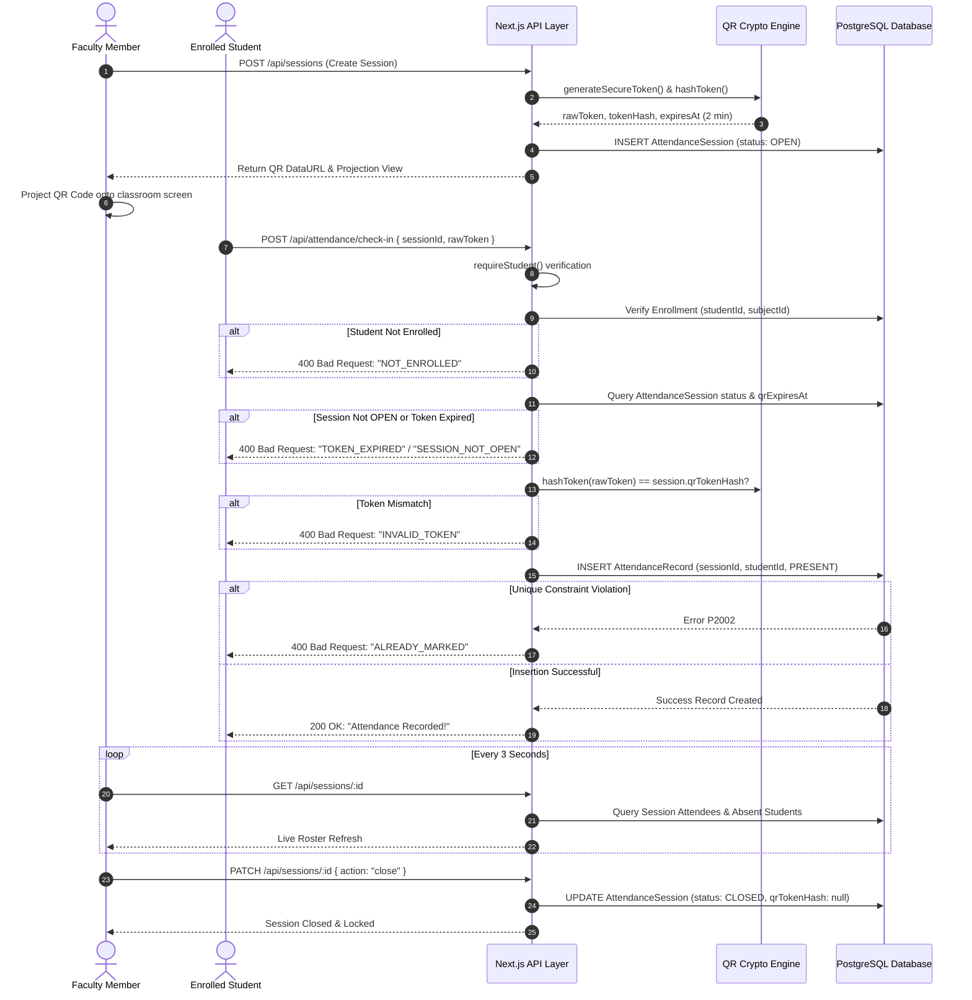

# System Architecture & Technical Design Document
## AMS — Smart Attendance Management System
**Version:** 1.0.0

---

## 1. High-Level System Architecture

AMS is structured as a full-stack unified SaaS application built on Next.js App Router, backed by PostgreSQL and Prisma ORM, and secured with role-based authorization.

```
┌─────────────────────────────────────────────────────────────────────────┐
│                        Presentation Layer (Next.js)                     │
│  ┌────────────────────┐   ┌────────────────────┐   ┌─────────────────┐  │
│  │  Admin Dashboard   │   │ Faculty Projection │   │ Student Portal  │  │
│  │  - Students/Faculty│   │ - Live QR Screen   │   │ - Mobile Camera │  │
│  │  - Course Roster   │   │ - Polling Roster   │   │ - Target Calc   │  │
│  └─────────▲──────────┘   └─────────▲──────────┘   └────────▲────────┘  │
└────────────┼────────────────────────┼───────────────────────┼───────────┘
             │                        │                       │
┌────────────▼────────────────────────▼───────────────────────▼───────────┐
│                    Application & API Routing Layer                      │
│  ┌───────────────────────────────────────────────────────────────────┐  │
│  │ Route Handlers (/api/students, /api/sessions, /api/attendance)   │  │
│  │ Zod Input Validation • RBAC Guard Middleware • Session Evaluator  │  │
│  └──────────────────────────────────▲────────────────────────────────┘  │
└─────────────────────────────────────┼───────────────────────────────────┘
                                      │
┌─────────────────────────────────────▼───────────────────────────────────┐
│                       Data Access & Logic Engine                        │
│  ┌──────────────────┐   ┌───────────────────┐   ┌────────────────────┐  │
│  │  Prisma ORM      │   │  QR Cryptography  │   │  Attendance Engine │  │
│  │  Singleton       │   │  SHA-256 Hashing  │   │  Target Calculator │  │
│  └────────▲─────────┘   └─────────▲─────────┘   └─────────▲──────────┘  │
└───────────┼───────────────────────┼───────────────────────┼─────────────┘
            │                       │                       │
┌───────────▼───────────────────────▼───────────────────────▼─────────────┐
│                    Persistence Layer (PostgreSQL)                       │
│  - Users & Profiles (Admin, Faculty, Student)                           │
│  - Subjects & Composite Unique Enrollments (studentId + subjectId)      │
│  - Attendance Sessions & Composite Unique Records (sessionId + student) │
│  - System Configuration & Policy Settings                               │
└─────────────────────────────────────────────────────────────────────────┘
```

---

## 2. Core Architectural Components

### 2.1 Next.js App Router & Server Components
- **Server Components:** Default execution model for dashboard overviews, student history, and initial state rendering, eliminating client-side waterfall queries.
- **Route Handlers:** Standard HTTP endpoints (`/api/...`) providing structured JSON responses and RFC 4180 CSV streams with appropriate HTTP status codes (200, 201, 400, 401, 403, 404, 500).
- **Client Primitives:** Reactive components for the live QR projector, camera scanner stream, and dev persona switcher.

### 2.2 Security & Authentication Boundary (`src/lib/auth.ts`)
- **Dual-Mode Adapter:**
  - Production mode: Validates session JWTs and user identity via Clerk Authentication.
  - Development / Demo mode: Utilizes cookie/header persona injection to simulate verified identities without mock databases.
  - Fail-Safe Guard: Fake authentication is programmatically disabled in production environments.
- **Server-Side Enforcement Functions:**
  - `requireAuth()`: Ensures caller has a valid database identity.
  - `requireAdmin()`: Restricts access to users with role `ADMIN`.
  - `requireFaculty()`: Enforces role `FACULTY` and attaches `FacultyProfile`.
  - `requireStudent()`: Enforces role `STUDENT` and attaches `StudentProfile`.

### 2.3 QR Cryptographic Engine (`src/lib/qr.ts`)
1. **Entropy Generation:** Generates 24-byte cryptographically secure pseudorandom tokens (`crypto.randomBytes`).
2. **One-Way Digest:** Hashes token using SHA-256 before persisting `qrTokenHash` in the database.
3. **Payload Structure:** QR encodes standard JSON `{ type: "AMS_ATTENDANCE", sessionId, token }`.
4. **Expiration Enforcement:** Checks `qrExpiresAt > new Date()` before processing check-ins.
5. **Atomic Uniqueness:** Relies on PostgreSQL unique constraints to reject race conditions and duplicate check-in submissions concurrently.

### 2.4 Attendance Calculation Engine (`src/lib/attendance.ts`)
- **Formula:**
  $$\text{Attendance \%} = \left(\frac{\text{Classes Attended (Present + Late)}}{\text{Eligible Classes Conducted}}\right) \times 100$$
- **Policy:** Evaluates only `CLOSED` sessions where the student had an active enrollment.
- **Target Calculator:**
  If attendance $< 75\%$, calculates consecutive classes $x$ required:
  $$x = \left\lceil \frac{0.75 \times C - A}{1 - 0.75} \right\rceil = \left\lceil \frac{0.75 \times C - A}{0.25} \right\rceil$$

---

## 3. Data Flow Diagram: Attendance Marking Lifecycle



---

## 4. Technology Stack Justification

| Layer | Chosen Technology | Architectural Rationale |
|---|---|---|
| **Framework** | Next.js 16 (App Router) | Unified SSR, Route Handlers, and static optimization in a single deployment artifact. |
| **Language** | TypeScript (Strict Mode) | Full-stack end-to-end type safety from database schemas to client UI components. |
| **Database** | PostgreSQL 16 (Neon / Local) | ACID transactional compliance, relational constraints, and production pooler support. |
| **ORM** | Prisma ORM 6.19 | Declarative schemas, automated migrations, foreign keys, and type-safe query generation. |
| **Authentication** | Clerk (with Dev Adapter) | Enterprise OAuth and identity provider support with seamless zero-credential dev fallback. |
| **Styling** | Tailwind CSS v4 | High-performance compiled utility classes enforcing consistent design tokens. |
| **Testing** | Vitest | Extremely fast in-memory execution compatible with ESM and Prisma query engine. |
| **QR Code** | `qrcode` & `html5-qrcode` | Maintained SVG/Canvas generators and browser WebRTC camera stream scanner. |
