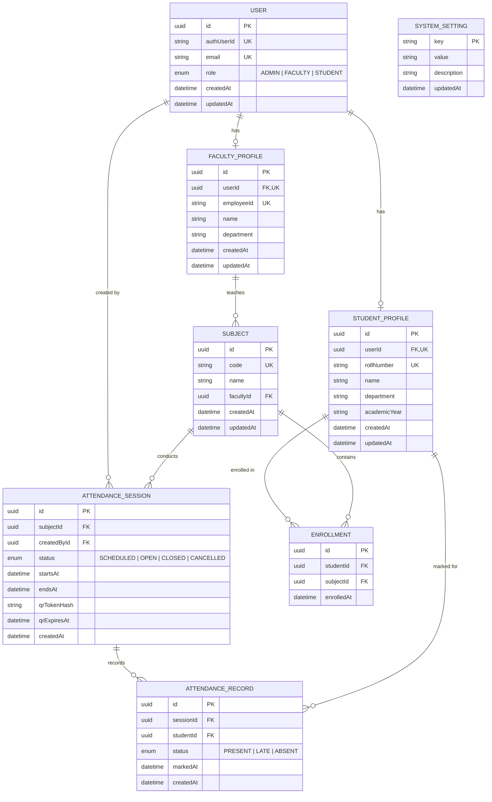

# Entity-Relationship (ER) Diagram & Data Dictionary
## AMS — Smart Attendance Management System
**Version:** 1.0.0

---

## 1. Mermaid Entity-Relationship Diagram

---

## 2. Relational Schema Data Dictionary

### 2.1 Table: `users`
Represents core identity and authentication records.
| Field | Type | Modifiers | Description |
|---|---|---|---|
| `id` | UUID | PK, `@default(uuid())` | System primary key. |
| `authUserId` | VARCHAR(255) | UNIQUE, NOT NULL | External Clerk identity ID or unique auth key. |
| `email` | VARCHAR(255) | UNIQUE, NOT NULL | Verified institutional email address. |
| `role` | ENUM | NOT NULL, DEFAULT 'STUDENT' | Role: `ADMIN`, `FACULTY`, `STUDENT`. |
| `createdAt` | TIMESTAMP | NOT NULL, DEFAULT now() | Account creation timestamp. |
| `updatedAt` | TIMESTAMP | NOT NULL | Last update timestamp. |

### 2.2 Table: `student_profiles`
Academic details for student users.
| Field | Type | Modifiers | Description |
|---|---|---|---|
| `id` | UUID | PK, `@default(uuid())` | System primary key. |
| `userId` | UUID | FK(users.id), UNIQUE | One-to-one relationship with `users` (ON DELETE CASCADE). |
| `rollNumber` | VARCHAR(64) | UNIQUE, NOT NULL | Official university roll number (e.g. `URK25CS1140`). |
| `name` | VARCHAR(255) | NOT NULL | Full student legal name. |
| `department` | VARCHAR(255) | NOT NULL | Academic branch (e.g., Computer Science & Engineering). |
| `academicYear` | VARCHAR(64) | NOT NULL | Cohort (e.g., `2024-2028 (2nd Year)`). |

### 2.3 Table: `faculty_profiles`
Academic details for instructors.
| Field | Type | Modifiers | Description |
|---|---|---|---|
| `id` | UUID | PK, `@default(uuid())` | System primary key. |
| `userId` | UUID | FK(users.id), UNIQUE | One-to-one relationship with `users` (ON DELETE CASCADE). |
| `employeeId` | VARCHAR(64) | UNIQUE, NOT NULL | Faculty staff identifier (e.g. `EMP-CS-101`). |
| `name` | VARCHAR(255) | NOT NULL | Faculty name and academic title. |
| `department` | VARCHAR(255) | NOT NULL | Faculty department affiliation. |

### 2.4 Table: `subjects`
Accredited course curriculum.
| Field | Type | Modifiers | Description |
|---|---|---|---|
| `id` | UUID | PK, `@default(uuid())` | System primary key. |
| `code` | VARCHAR(32) | UNIQUE, NOT NULL | Standard course code (e.g. `CS2041`). |
| `name` | VARCHAR(255) | NOT NULL | Course title (e.g. `Software Engineering`). |
| `facultyId` | UUID | FK(faculty_profiles.id) | Authorized faculty instructor (ON DELETE RESTRICT). |

### 2.5 Table: `enrollments`
Course registration junction table.
| Field | Type | Modifiers | Description |
|---|---|---|---|
| `id` | UUID | PK, `@default(uuid())` | System primary key. |
| `studentId` | UUID | FK(student_profiles.id) | Student profile reference (ON DELETE CASCADE). |
| `subjectId` | UUID | FK(subjects.id) | Subject reference (ON DELETE CASCADE). |
| `enrolledAt` | TIMESTAMP | NOT NULL, DEFAULT now() | Enrollment timestamp. |
- **Composite Unique Constraint:** `@@unique([studentId, subjectId])` prevents duplicate registrations.

### 2.6 Table: `attendance_sessions`
Live or completed attendance periods.
| Field | Type | Modifiers | Description |
|---|---|---|---|
| `id` | UUID | PK, `@default(uuid())` | System primary key. |
| `subjectId` | UUID | FK(subjects.id) | Associated course (ON DELETE RESTRICT). |
| `createdById`| UUID | FK(users.id) | Faculty creator (ON DELETE RESTRICT). |
| `status` | ENUM | NOT NULL, DEFAULT 'OPEN'| Lifecycle: `SCHEDULED`, `OPEN`, `CLOSED`, `CANCELLED`. |
| `startsAt` | TIMESTAMP | NOT NULL, DEFAULT now() | Session commencement time (UTC). |
| `endsAt` | TIMESTAMP | NULLABLE | Concluded time (UTC). |
| `qrTokenHash`| VARCHAR(64) | NULLABLE | SHA-256 hash of currently active QR token. |
| `qrExpiresAt`| TIMESTAMP | NULLABLE | QR code expiration timestamp. |

### 2.7 Table: `attendance_records`
Individual student check-in records.
| Field | Type | Modifiers | Description |
|---|---|---|---|
| `id` | UUID | PK, `@default(uuid())` | System primary key. |
| `sessionId` | UUID | FK(attendance_sessions.id) | Associated session (ON DELETE CASCADE). |
| `studentId` | UUID | FK(student_profiles.id) | Student profile (ON DELETE RESTRICT). |
| `status` | ENUM | NOT NULL, DEFAULT 'PRESENT' | Status: `PRESENT`, `LATE`, `ABSENT`. |
| `markedAt` | TIMESTAMP | NOT NULL, DEFAULT now() | Exact timestamp of verification (UTC). |
- **Composite Unique Constraint:** `@@unique([sessionId, studentId])` prevents duplicate check-ins at the database engine level.
