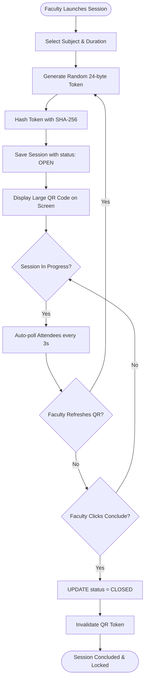
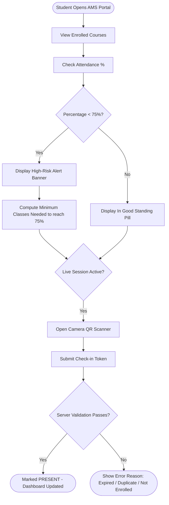

# Use Cases & Workflow Specifications
## AMS — Smart Attendance Management System
**Version:** 1.0.0

---

## 1. System Actors

1. **System Administrator (`ADMIN`):**
   - Responsible for institutional setup, registering faculty and students, defining curriculum courses, managing student enrollments, configuring regulatory attendance thresholds, and auditing cross-departmental compliance.
2. **Faculty Member (`FACULTY`):**
   - Accredited instructor in charge of assigned courses. Launches attendance sessions, projects rolling QR codes, monitors real-time student check-ins, concludes sessions, and exports official attendance sheets.
3. **Student (`STUDENT`):**
   - Enrolled learner. Scans live QR codes to mark attendance, tracks subject-wise percentages, receives early warning notifications when falling below the regulatory threshold, and reviews historical attendance timelines.

---

## 2. Use Case Summary Matrix

| Use Case ID | Actor(s) | Title | Primary Precondition | Expected Postcondition |
|---|---|---|---|---|
| **UC-01** | All | Authenticate & Switch Persona | Account exists | User session established with role privileges |
| **UC-02** | Admin | Enroll Student in Course | Student & Subject exist | Student authorized for attendance sessions |
| **UC-03** | Admin | Configure Threshold Policy | Admin privileges | Global threshold updated (e.g. 75%) |
| **UC-04** | Faculty | Launch QR Attendance Session | Faculty assigned to Subject | Live session created with expiring QR token |
| **UC-05** | Faculty | Refresh Dynamic QR Token | Session status is `OPEN` | Token refreshed with new 2-min window |
| **UC-06** | Student | Mark Attendance via QR Scan | Session is `OPEN`, Student enrolled | Attendance record created as `PRESENT` |
| **UC-07** | Student | Compute Classes Needed | Student below threshold | Exact count of required consecutive sessions calculated |
| **UC-08** | Faculty | Export Session Attendance CSV | Session exists, Faculty owns course | RFC 4180 CSV downloaded to device |
| **UC-09** | Faculty/Admin | Conclude Attendance Session | Session status is `OPEN` | Session status set to `CLOSED`, tokens invalidated |

---

## 3. Detailed Use Case Specifications

### UC-04: Launch QR Attendance Session
- **Actor:** Faculty Member
- **Trigger:** Faculty commences a scheduled class lecture.
- **Main Flow:**
  1. Faculty navigates to `/faculty/sessions/new`.
  2. Faculty selects assigned course subject and chooses class duration (default 50 min) and QR expiry (default 2 min).
  3. Faculty clicks "Open Session & Display QR Code".
  4. Server verifies faculty ownership of subject.
  5. Server generates cryptographically random token, hashes it via SHA-256, and stores record in `attendance_sessions` with status `OPEN`.
  6. Server generates QR code Data URL containing `{ type: "AMS_ATTENDANCE", sessionId, token }`.
  7. Client redirects to `/faculty/sessions/[id]` and displays large projection QR code.
- **Alternative Flow:**
  - *Unauthorized subject:* Server returns HTTP 403 Forbidden.

### UC-06: Mark Attendance via QR Scan
- **Actor:** Enrolled Student
- **Trigger:** Student scans classroom projection screen with device camera.
- **Main Flow:**
  1. Student accesses `/student/scan`.
  2. Camera scanner captures QR code payload or student enters token code manually.
  3. Client dispatches `POST /api/attendance/check-in` with `sessionId` and `token`.
  4. Server validates student session, role, and enrollment in the subject.
  5. Server verifies session status is `OPEN`.
  6. Server hashes submitted token and matches against stored `qrTokenHash`.
  7. Server verifies current timestamp is prior to `qrExpiresAt`.
  8. Server verifies no existing record exists in `attendance_records` for `(sessionId, studentId)`.
  9. Server creates record with status `PRESENT` and timestamp.
  10. Server returns success response; client displays confirmation card with green checkmark.
- **Exception Flows:**
  - *Not enrolled:* Check-in rejected with message "You are not enrolled in this course".
  - *Expired QR:* Check-in rejected with "The QR code has expired. Please ask faculty to refresh".
  - *Duplicate check-in:* Check-in rejected with "Attendance already recorded at [timestamp]".
  - *Concluded session:* Check-in rejected with "Attendance session is concluded".

---

## 4. Workflows

### 4.1 Faculty Session Management & Live Attendance Loop

### 4.2 Student Verification & Target Shortfall Workflow

